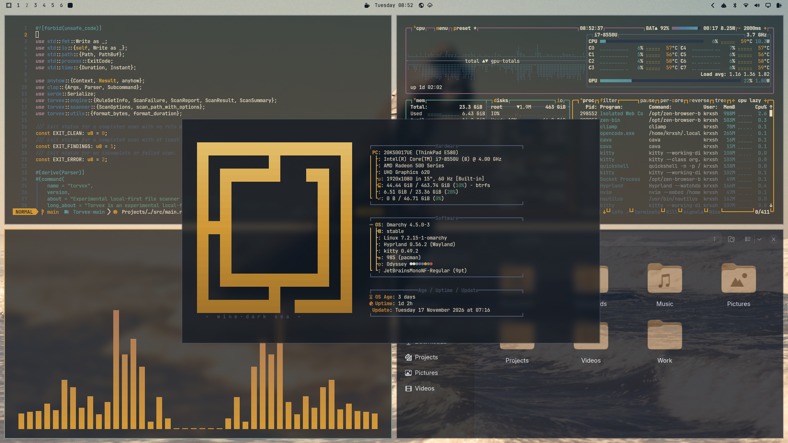

# Odyssey

An Omarchy theme after Homer: the wine-dark Aegean, weathered bronze, sun-bleached
marble, and the hearth firelight of Ithaca.



## Install

```bash
omarchy theme install https://github.com/Vy7i3/omarchy-odyssey-theme
```

Then pick **Odyssey** under **Style → Theme** (or run `omarchy theme set odyssey`).

To install by hand, clone this repository into
`~/.config/omarchy/themes/odyssey` and run `omarchy theme set odyssey`.

The boot and lock screen artwork is included. Apply it with:

```bash
omarchy plymouth set by theme odyssey
```

The palette was tuned against Omarchy's native Glassy transparency. Turn it on
with `omarchy hyprland window transparency glassy` for blurred terminal and
panel backgrounds, or leave it off for a fully opaque desktop.

## Palette

| Role | Hex | |
|------|-----|---|
| Background | `#111824` | Primary Aegean slate-navy |
| Darker background | `#090d14` | Deep trench midnight |
| Lighter background | `#1b2536` | Elevated panels and selections |
| Foreground | `#e6dec8` | Sun-bleached parchment — 13.3:1 on background (WCAG AAA) |
| Bright foreground | `#faf6eb` | Polished Parian marble — 16.4:1 on background |
| Accent | `#d49a35` | Burnished Minoan bronze |
| Selection | `#26334a` | Deep wave highlight |
| Muted | `#4a586e` | Weathered stone |
| Red | `#c94a4a` | Wine-dark crimson |
| Green | `#5c8d76` | Ithacan olive leaf |
| Blue | `#4b7ba6` | Aegean open water |
| Magenta | `#8c5e7a` | Tyrian purple |
| Cyan | `#58999e` | Seafoam and Siren shoals |

## What's included

- `colors.toml` — the palette every Omarchy component reads.
- `btop.theme` — bronze meters, teal CPU graphs, seafoam memory gradients.
- `icons.theme` — pairs with the `Yaru-wartybrown` icon set.
- `backgrounds/` — six 4K wallpapers, cycled by `omarchy theme bg next`.
- `preview.png`, `preview-unlock.png`, `unlock.png` — theme and Plymouth artwork.
- `fastfetch.jsonc` — the bronze **ODYSSEY** emblem for `fastfetch` (optional;
  copy it to `~/.config/fastfetch/config.jsonc`).

## Wallpapers

Collected on [Wallhaven](https://wallhaven.cc); rights remain with the original
creators and studios.

| File | Motif | Source |
|------|-------|--------|
| `wallhaven-e86m9o.jpg` | The Odyssey (2026) — the horse in the sea | <https://wallhaven.cc/w/e86m9o> |
| `wallhaven-21oqmg.jpg` | The Odyssey (2026) — bronze horse against gold | <https://wallhaven.cc/w/21oqmg> |
| `wallhaven-8g9yy1.jpg` | The Odyssey (2026) — Greek soldiers by torchlight | <https://wallhaven.cc/w/8g9yy1> |
| `wallhaven-d8o77l.jpg` | The Odyssey (2026) — Agamemnon before the gates | <https://wallhaven.cc/w/d8o77l> |
| `wallhaven-6k1d8w.jpg` | Assassin's Creed Odyssey — night coast | <https://wallhaven.cc/w/6k1d8w> |
| `wallhaven-xly6r3.jpg` | Assassin's Creed Odyssey — sunset at sea | <https://wallhaven.cc/w/xly6r3> |

## License

The theme files are released under the [MIT license](LICENSE). The wallpapers
are excluded and remain the property of their original creators.
